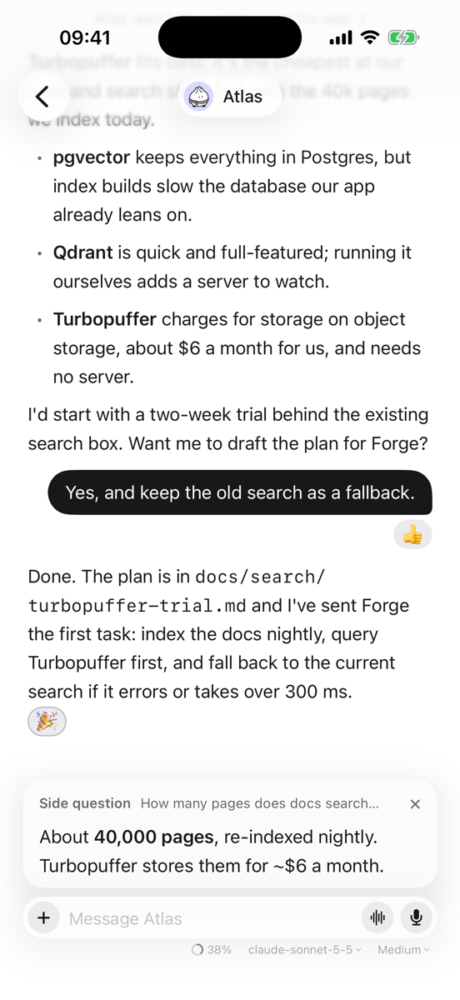

# Usual Bot

A native Mac and iPhone client for [Hermes Agent](https://github.com/NousResearch/hermes-agent).
Your Hermes profiles show up as contacts in a simple messenger: one ongoing chat per agent,
group rooms, inline approvals and routines. Everything else stays in the official Hermes app.


<p>
  
  
</p>

## What it does

- **One chat per agent.** Each profile's ongoing "Bot Chat", with streaming replies, Markdown,
  and tool calls folded into one line you can open.
- **Images and files both ways.** Attach photos, PDFs and other files to a message; images an
  agent makes or finds show inline, open full size, and can be shared or saved.
- **Approvals and questions inline.** When an agent wants to run a command, allow it once, for the
  chat, always, or deny it, right in the conversation. Questions from its clarify tool show up the
  same way.
- **React, reply and copy.** Hover a message (long-press on iPhone) to react with an emoji,
  reply to it with a quote, or copy it.
- **Stop and steer.** Stop a running turn, or send a message while it runs to steer it.
- **Rooms.** Group chats with several agents. Messages go to everyone; `@name` talks to one.
- **Skills and commands.** Type `/` to run one of the agent's skills or commands; switch skills on
  and off in its profile.
- **Side questions.** `/btw` asks about the conversation while the agent works, without
  interrupting it; the answer appears above the message box.
- **Background tasks.** `/bg` hands a task to a fresh agent while you keep chatting; its result
  joins the chat, with a notification if the app isn't in front.
- **Edit and undo.** Rewrite your last message for a fresh reply, or take it back.
- **Model and thinking.** Pick the model and how hard it thinks for each chat from the message
  box; the agent's default stays as it is. A small meter shows how full the context is, with a
  button to compress it.
- **Routines.** Each agent's scheduled jobs, with a switch to pause and resume them.
- **Dictation.** Tap the mic in an empty message box and speak; words appear as you talk,
  recognised on the device when it can.
- **Voice calls.** Talk with an agent: it hears you, answers aloud as it writes, and stops when
  you speak over it. Use on-device speech, or Hermes's GPT-Live voice when your gateway has an
  OpenAI key. The conversation stays in the chat.
- **Quick message (Mac).** Press ⌥Space anywhere to message an agent without opening the window.
- **Works offline.** The last chats are cached, and the app reconnects by itself.

The sidebar shows which agents are working and which need you. Settings, skills and everything
else stay in the official Hermes app.


## What you need

- A Hermes gateway you can reach from the device: on your tailnet, on your home network, or on
  the internet over `https`. Plain `http` is allowed only for private and Tailscale addresses.
  On iPhone, a tailnet gateway works only while Tailscale is on.
- Browser sign-in for native apps on the gateway (`native_pkce` in its `/api/status`).
- Tested with the Hermes dashboard (port 9119) on Hermes Agent 0.21.5 and 0.22.5. Gateways that
  speak Hermes's newer canonical session protocol connect, but chats there aren't supported yet.

Sign in once with the gateway's address, for example `100.64.0.1:9119`. The app opens the
gateway's sign-in page and keeps the session in the Keychain.

## Build

Requirements: Xcode 26 or newer. The app targets macOS 15 and iOS 18, and was tested on
macOS 27, iOS 27 and the iOS 26 Simulator.

```sh
open UsualBot.xcodeproj
```

Pick the **UsualBot** scheme and a Mac or iPhone simulator, then Run. Unsigned and simulator builds
need no setup. To run on your own device, copy `Config/Local.xcconfig.example` to
`Config/Local.xcconfig` and set your team ID and bundle prefix (the file is gitignored).

Without a team, Mac builds are signed "to run locally", and every rebuild looks like a new app to
the Keychain: macOS asks once per build whether Usual Bot may read its saved sign-in. Choose
**Always Allow**, or set your team to make the prompt go away.

### Try it without a gateway

Debug builds started with `USUALBOT_DEMO=1` show a made-up team of agents, a room and routines
instead of signing in. Nothing is sent anywhere. In Xcode, add the variable under
**Product › Scheme › Edit Scheme › Run › Arguments**. From the command line:

```sh
USUALBOT_DEMO=1 path/to/Debug/UsualBot.app/Contents/MacOS/UsualBot
```

The screenshots above come from it.

## Layout

| Path | What lives there |
| --- | --- |
| `Packages/HermesKit` | Gateway connection, protocol types and state. No UI, no dependencies. |
| `Packages/UsualUI` | Shared SwiftUI screens for Mac and iPhone. |
| `App/` | The thin app shell and platform-only pieces (sign-in, the ⌥Space panel). |
| `Config/` | Build settings (`.xcconfig`), Info.plist and entitlements. |
| `design/` | The avatar characters and their design notes. |

Each package has an `AGENTS.md` and a `docs/agents/` folder describing how it works and its known
issues; start there before changing it.

## Checks

```sh
swift test --package-path Packages/HermesKit
swift test --package-path Packages/UsualUI
swift format lint --strict --recursive App Packages
```

CI runs the same checks and builds both platforms on every pull request.

## Contributing

See [CONTRIBUTING.md](CONTRIBUTING.md).

## License

Apache-2.0. See [LICENSE](LICENSE).
