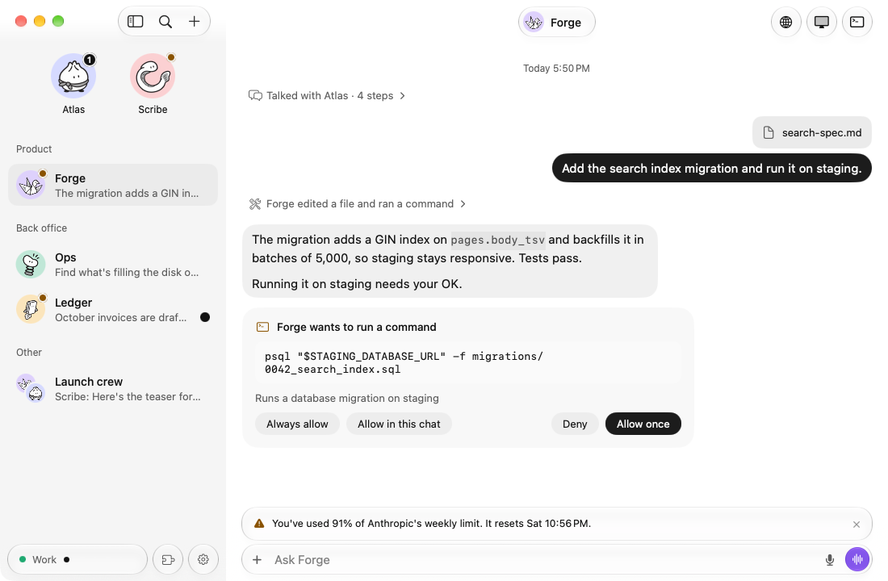
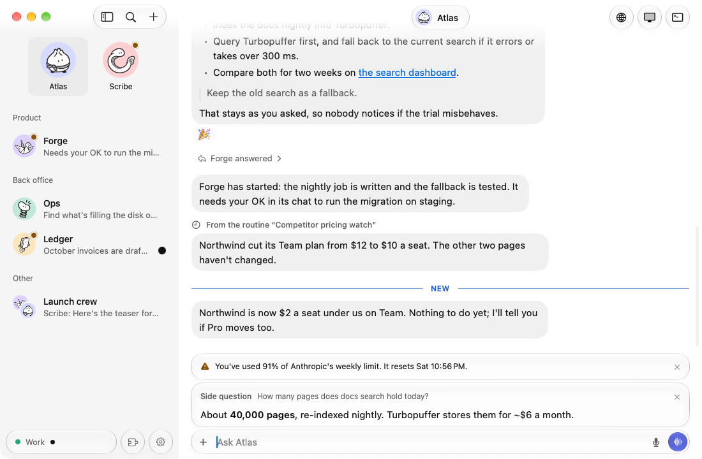
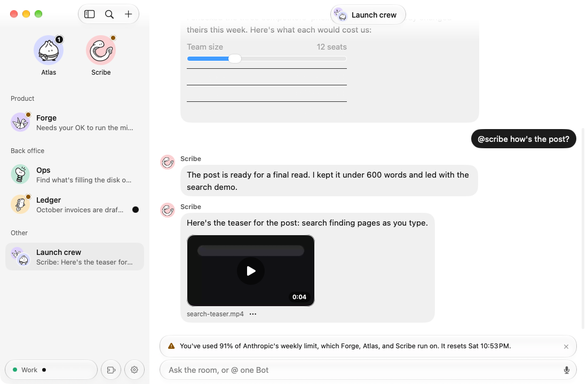
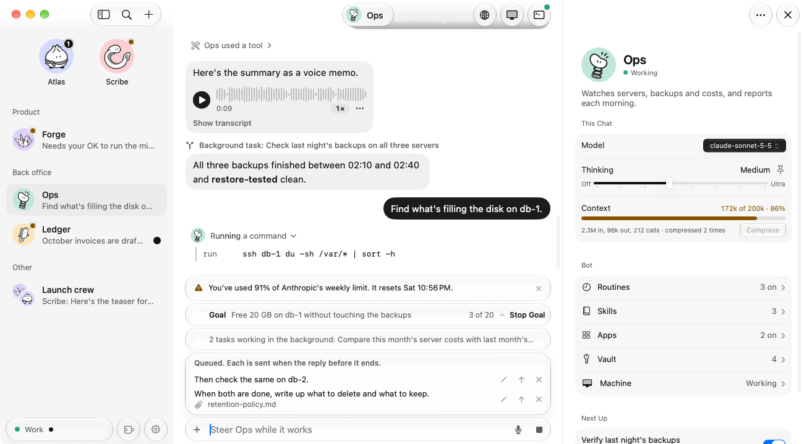
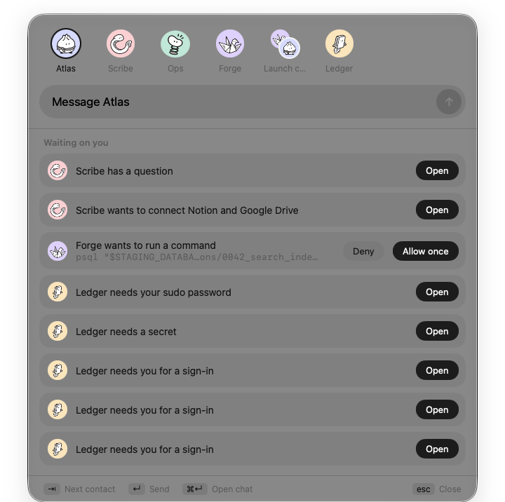
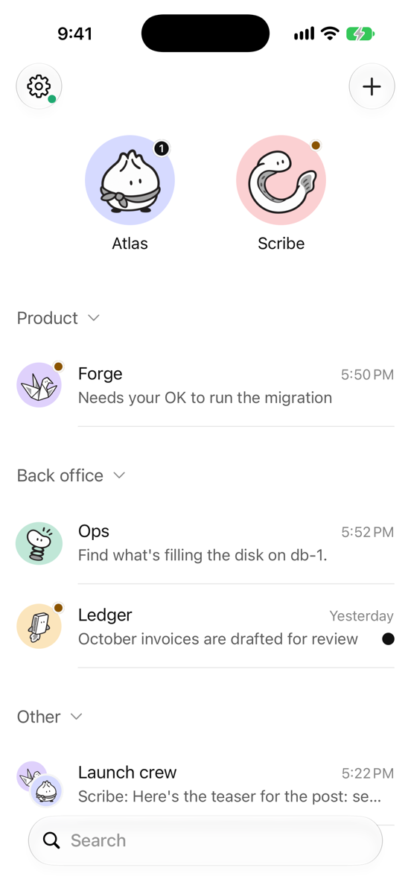
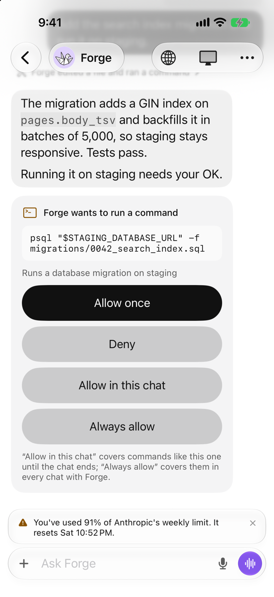
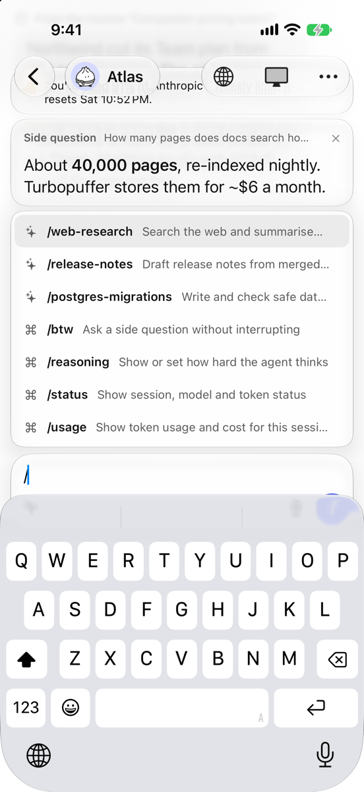
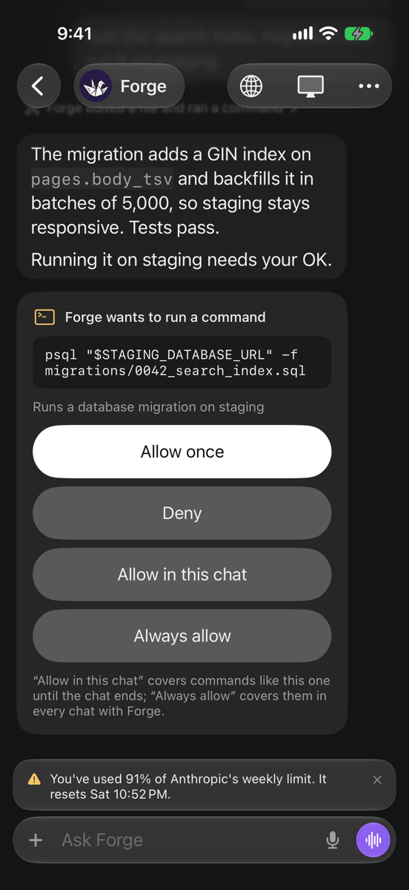

<p align="center">
  
</p>

<h1 align="center">Usual Bot</h1>

<p align="center">
  <strong>A new home for your <a href="https://github.com/NousResearch/hermes-agent">Hermes</a> Bots.</strong><br>
  A native messenger for Mac and iPhone.<br>
  Chat with your Bots, approve what they want to run, and group them in rooms.
</p>

<p align="center">
  <sub>Free and open source, and independent: not made by, affiliated with or endorsed by Nous Research.</sub>
</p>

<p align="center">
  
  
  
  
  <a href="LICENSE"></a>
  <a href="https://scorecard.dev/viewer/?uri=github.com/usual-labs/usual-bot"></a>
</p>

https://github.com/user-attachments/assets/3c48ca26-d8e7-4028-8acd-c5afce1ca191

Usual Bot connects to the Hermes gateway you already run and works with Hermes
[Bot Mode](https://hermes-agent.nousresearch.com/docs/user-guide/bot-mode): each Bot is a contact
with its one ongoing Bot Chat, group chats are rooms, and routines sit in each Bot's profile.
These are the same conversations you see in the Hermes desktop app. The sidebar shows which
Bots are working and which need you. It does one thing well: talking to your Bots. Agent configuration,
skill setup and gateway administration stay in the official Hermes app; a Bot's routines and MCP
servers, and making, renaming and deleting Bots, are here too.

> [!NOTE]
> Usual Bot is young. It's tested against Hermes's gateway Webapp and its older dashboard. See
> [What you need](#what-you-need).

## Install

Usual Bot is in beta on **TestFlight**, for the Mac and the iPhone:
**[join the beta](https://testflight.apple.com/join/y1wPqfUH)**. Install Apple's
[TestFlight](https://apps.apple.com/app/testflight/id899247664) app first, then open the link on
your Mac or iPhone. Needs macOS 26 or iOS 26 or later. You can also build it from source (below).

The Homebrew cask and the GitHub download stopped at version 0.3.0. If you installed one, join
the beta to keep getting updates.

Then sign in to your gateway; [Getting started](docs/guides/getting-started.md#2-get-your-gateway-ready)
shows what it needs.

## Build from source

**Try it in a minute, without a gateway.** You need a Mac with Xcode 27 or newer.

```sh
git clone https://github.com/usual-labs/usual-bot.git
cd usual-bot
xcodebuild -project UsualBot.xcodeproj -scheme UsualBot -destination 'platform=macOS' \
  -derivedDataPath build build
USUALBOT_DEMO=1 build/Build/Products/Debug/UsualBot.app/Contents/MacOS/UsualBot
```

That opens a made-up team of Bots, a room and some routines. Nothing is sent anywhere.

**Use it with your own Bots.**

1. `open UsualBot.xcodeproj`, pick the **UsualBot** scheme and **My Mac** (or an iPhone simulator),
   and press **Run**.
2. Turn on your Hermes gateway's Webapp, and make sure this device can reach it and it has a
   sign-in set up. [Getting started](docs/guides/getting-started.md#2-get-your-gateway-ready)
   shows how.
3. In Usual Bot, enter the gateway's address, for example `https://hermes.example.com`, and sign in
   on the gateway's page that opens. Your Bots appear as contacts.

To run it on your own iPhone, set your Apple team in `Config/Local.xcconfig` first; see
[Getting started](docs/guides/getting-started.md#run-it-on-your-iphone).

## Screenshots



<table>
  <tr>
    <td width="50%"></td>
    <td width="50%"></td>
  </tr>
  <tr>
    <td>A chat, with a <code>/btw</code> side question answered while the Bot keeps working.</td>
    <td>A room: messages go to every Bot, <code>@name</code> talks to one.</td>
  </tr>
  <tr>
    <td></td>
    <td></td>
  </tr>
  <tr>
    <td>A Bot's routines beside its chat, and two background tasks running.</td>
    <td>Press ⌥Space anywhere to message a Bot or answer an approval.</td>
  </tr>
</table>

<p align="center">
  
  
  
  
</p>

The film and all screenshots come from the built-in demo, with made-up Bots.

## Features

**Chatting**

- **One chat per Bot.** Each Bot's ongoing Bot Chat from Hermes Bot Mode, with streaming
  replies, Markdown, and tool calls folded into one line you can open.
- **Images and files both ways.** Attach photos, PDFs and other files. Images a Bot makes or
  finds show inline, open full size, and can be shared or saved.
- **React, reply and copy.** Hover a message (long-press on iPhone) to react, quote it in a reply,
  or copy it.
- **Edit and undo.** Rewrite your last message for a fresh answer, or take it back.
- **Dictation.** Tap the mic and speak; your words appear as you talk.
- **Voice calls.** Talk with a Bot and it answers aloud, and stops when you speak over it. Uses
  on-device speech, the Bot's own speech providers on your gateway, or Hermes's GPT-Live voice
  when your gateway has an OpenAI key.

**Staying in control**

- **Approvals and questions inline.** When a Bot wants to run a command, allow it once, for this
  chat, always, or deny it, right in the conversation. Secrets and sudo passwords are asked for in a masked field.
- **Stop, steer and queue.** Stop a running reply, send a message while it runs to change course,
  or queue one for when it ends.
- **Goals.** Give a Bot a goal with `/goal` and it keeps working on it reply after reply. The goal
  shows above the message box with how far along it is, and one button stops it.
- **Model and thinking.** Pick each chat's model and how hard it thinks in the Bot's profile. A
  small meter there shows how full the context is, with a button to compress it.
- **Needs you.** The sidebar marks Bots that are working and Bots waiting on you.

**Getting more done**

- **Skills and commands.** Type `/` anywhere in a message for the Bot's skills and Hermes
  commands, such as `/reasoning` or `/status`.
- **Side questions.** `/btw` asks about the conversation without interrupting the Bot.
- **Background tasks.** `/bg` has the Bot do a task in the background while you keep chatting. You get a
  notification when it's done while the app runs; otherwise the result is there when you next open it.
- **Push.** With the `usual-bot` plugin on your gateway, your Mac and iPhone hear from your Bots
  even when Usual Bot is closed, sealed so nothing in between can read it. Push needs the
  TestFlight app; a copy you build yourself alerts only while it runs.
- **Rooms.** Group chats with several Bots.
- **Routines.** Each Bot's scheduled jobs, with a switch to pause and resume them.
- **Quick message (Mac).** ⌥Space opens a small panel to message any Bot from anywhere.
- **Works offline.** Recent chats are cached, and the app reconnects by itself and catches up on
  what it missed.

The [user guide](docs/guides/user-guide.md) walks through each of these.

## What you need

- **A Hermes gateway** with its Webapp on (`webapp.enabled`, port 9120), reachable from your
  device: on your tailnet, your home network, or the internet over `https`. Plain `http` is
  allowed only for private and Tailscale addresses. The older dashboard (`hermes dashboard`, port
  9119) works too, but there routines and other Bots can't post into your chats.
- **Sign-in on the gateway.** It needs a sign-in method (username and password, or OAuth); Usual
  Bot uses its browser sign-in for apps (`native_pkce` in `/api/status`).
- **Tested with** Hermes Agent 0.22.7 to 0.23.3 (the Webapp), and 0.21.5 and 0.22.5 (the dashboard).
- **The app** runs on macOS 26 and iOS 26 or later. Building it needs Xcode 27 or newer.

## Documentation

| Guide | For |
| --- | --- |
| [Getting started](docs/guides/getting-started.md) | Building the app, preparing your gateway and signing in |
| [User guide](docs/guides/user-guide.md) | Every feature, with keyboard shortcuts |
| [Troubleshooting](docs/guides/troubleshooting.md) | What error messages mean and how to fix them |
| [Architecture](docs/guides/architecture.md) | How the code is laid out and talks to the gateway |
| [Releasing](docs/guides/releasing.md) | For maintainers: shipping a build through TestFlight |
| [Contributing](CONTRIBUTING.md) | Setting up, checks, and how to send a pull request |
| [Changelog](CHANGELOG.md) | What changed in each version |

## Project layout

| Path | What lives there |
| --- | --- |
| `Packages/HermesKit` | Gateway sign-in, connection, protocol types and app state. No UI, no dependencies. |
| `Packages/UsualUI` | The SwiftUI screens, shared by Mac and iPhone. |
| `Packages/Tailnet` | Built-in Tailscale on iPhone, around Tailscale's TailscaleKit. |
| `App/` | The thin app shell and platform pieces (sign-in, the ⌥Space panel, notifications). |
| `NotificationService/`, `ShareExtension/` | The notification and share extensions. |
| `Config/` | Build settings (`.xcconfig`), Info.plist and entitlements. |
| `Integrations/usual-bot` | The Hermes plugin for push, a Bot's browser and terminal. Runs on your gateway. |
| `Services/` | The push relay and the TestFlight update check (Cloudflare Workers). |
| `scripts/` | Checks, the TestFlight upload and release helpers. |
| `design/` | The avatar characters, including the one the app icon is drawn from. |

## Contributing

Bug reports, fixes, accessibility work and protocol support are very welcome. Start with
[CONTRIBUTING.md](CONTRIBUTING.md); everyone taking part follows the
[Code of Conduct](CODE_OF_CONDUCT.md). Found a security problem? Please follow
[SECURITY.md](SECURITY.md) instead of opening an issue.

## License

Usual Bot is licensed under the [Apache License 2.0](LICENSE). Hermes Agent is a separate project
by Nous Research under its own license.

The iPhone app includes TailscaleKit from
[libtailscale](https://github.com/tailscale/libtailscale) for Built-in Tailscale, under this
license:

<details>
<summary>libtailscale (BSD 3-Clause)</summary>

```text
BSD 3-Clause License

Copyright (c) 2023 Tailscale & AUTHORS.
All rights reserved.

Redistribution and use in source and binary forms, with or without
modification, are permitted provided that the following conditions are met:

1. Redistributions of source code must retain the above copyright notice, this
   list of conditions and the following disclaimer.

2. Redistributions in binary form must reproduce the above copyright notice,
   this list of conditions and the following disclaimer in the documentation
   and/or other materials provided with the distribution.

3. Neither the name of the copyright holder nor the names of its
   contributors may be used to endorse or promote products derived from
   this software without specific prior written permission.

THIS SOFTWARE IS PROVIDED BY THE COPYRIGHT HOLDERS AND CONTRIBUTORS "AS IS"
AND ANY EXPRESS OR IMPLIED WARRANTIES, INCLUDING, BUT NOT LIMITED TO, THE
IMPLIED WARRANTIES OF MERCHANTABILITY AND FITNESS FOR A PARTICULAR PURPOSE ARE
DISCLAIMED. IN NO EVENT SHALL THE COPYRIGHT HOLDER OR CONTRIBUTORS BE LIABLE
FOR ANY DIRECT, INDIRECT, INCIDENTAL, SPECIAL, EXEMPLARY, OR CONSEQUENTIAL
DAMAGES (INCLUDING, BUT NOT LIMITED TO, PROCUREMENT OF SUBSTITUTE GOODS OR
SERVICES; LOSS OF USE, DATA, OR PROFITS; OR BUSINESS INTERRUPTION) HOWEVER
CAUSED AND ON ANY THEORY OF LIABILITY, WHETHER IN CONTRACT, STRICT LIABILITY,
OR TORT (INCLUDING NEGLIGENCE OR OTHERWISE) ARISING IN ANY WAY OUT OF THE USE
OF THIS SOFTWARE, EVEN IF ADVISED OF THE POSSIBILITY OF SUCH DAMAGE.
```

</details>

Hermes and Hermes Agent are names of Nous Research. Usual Bot's icon is a fan drawing of the
Hermes Agent character. Usual Bot is an independent project: it isn't made by, affiliated with or
endorsed by Nous Research.
