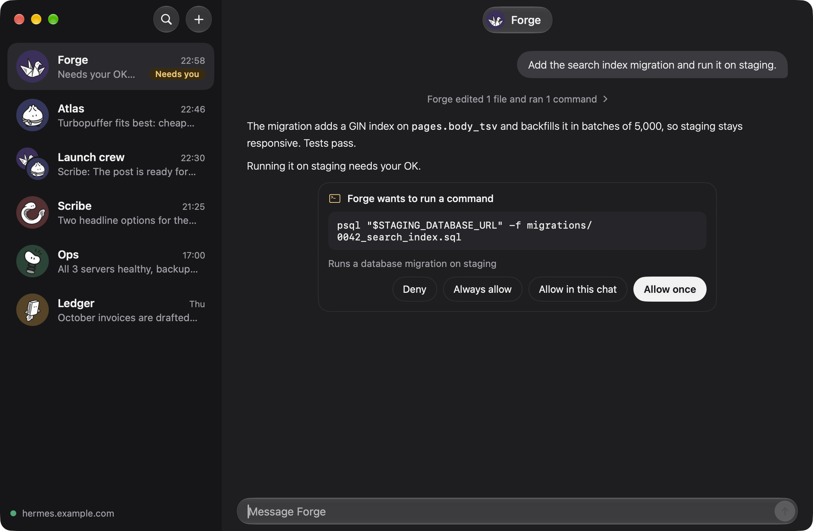
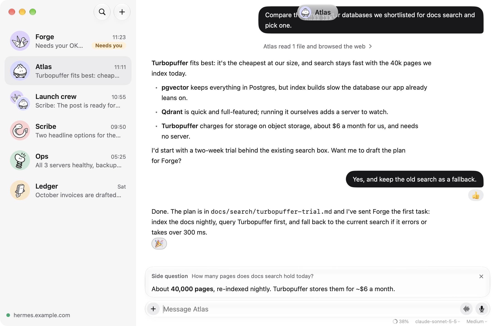
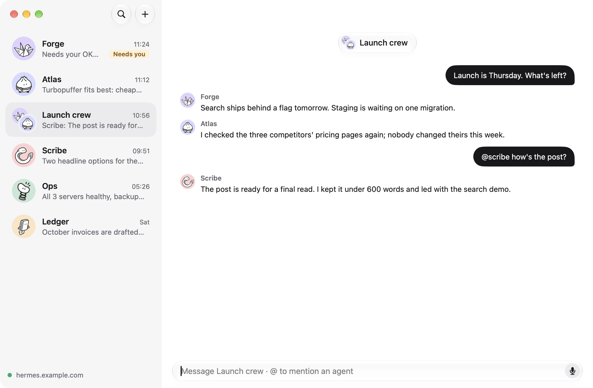
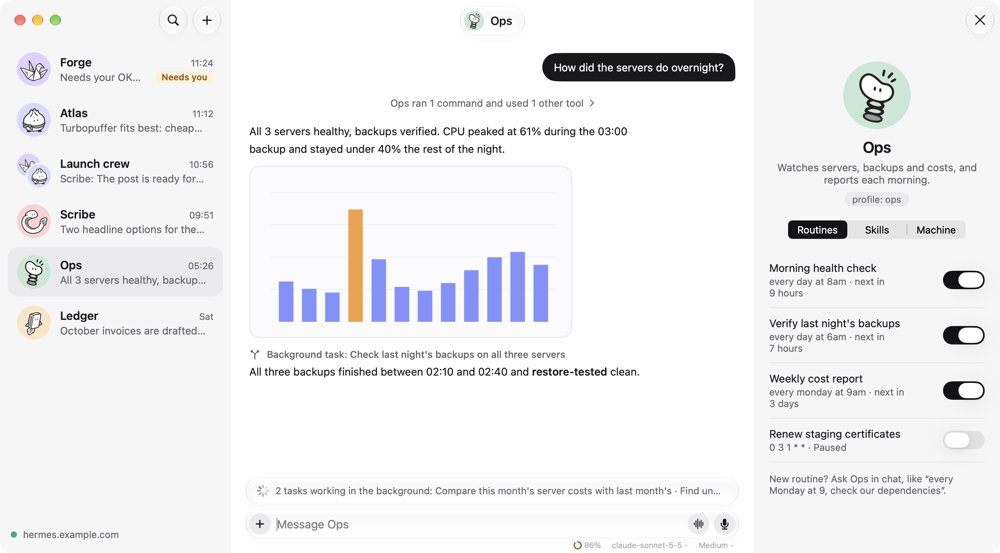
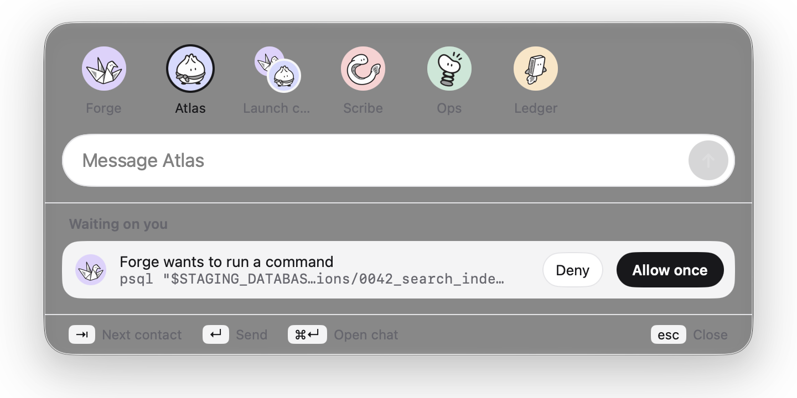
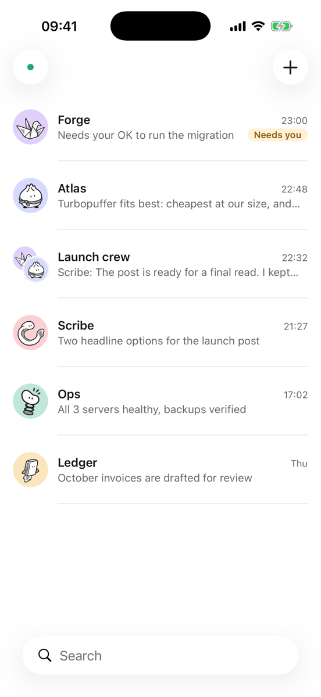
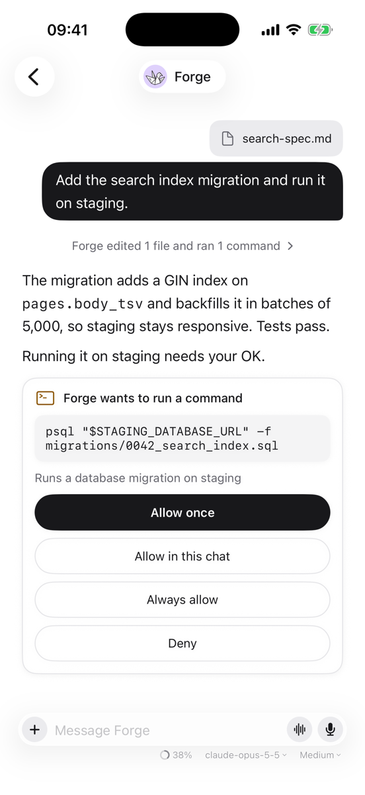
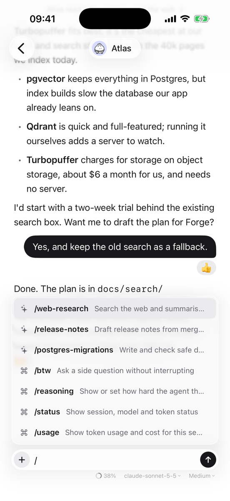
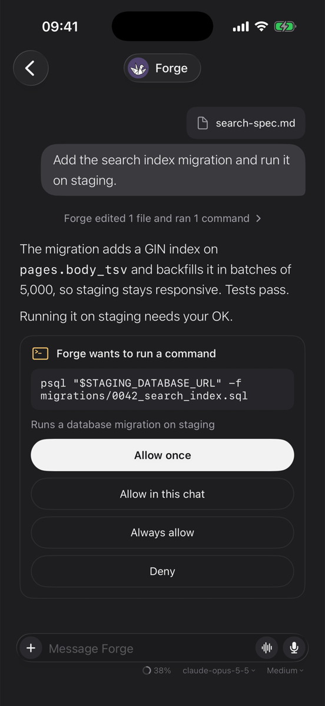

<p align="center">
  
</p>

<h1 align="center">Usual Bot</h1>

<p align="center">
  <strong>A new home for your <a href="https://github.com/NousResearch/hermes-agent">Hermes</a> Bots.</strong><br>
  A native messenger for Mac and iPhone.<br>
  Chat with your Bots, approve what they want to run, and group them in rooms.
</p>

<p align="center">
  
  
  
  
  <a href="LICENSE"></a>
  <a href="https://scorecard.dev/viewer/?uri=github.com/usual-labs/usual-bot"></a>
</p>

https://github.com/user-attachments/assets/3c48ca26-d8e7-4028-8acd-c5afce1ca191

Usual Bot connects to the Hermes gateway you already run and works with Hermes
[Bot Mode](https://hermes-agent.nousresearch.com/docs/user-guide/bot-mode): each Bot is a contact
with its one ongoing Bot Chat, group chats are rooms, and routines sit in each Bot's profile.
These are the same conversations you see in the Hermes desktop app. The sidebar shows which
agents are working and which need you. It does one thing well: talking to your agents. Settings,
skill setup and everything else stay in the official Hermes app.

> [!NOTE]
> Usual Bot is an independent open-source project, not made by Nous Research. It's young, and it's
> tested against the Hermes dashboard gateway. See [What you need](#what-you-need).

## Install

**Mac:** install it with [Homebrew](https://brew.sh):

```bash
brew install --cask usual-labs/tap/usual-bot
```

Or download `UsualBot-<version>.dmg` from the
[latest release](https://github.com/usual-labs/usual-bot/releases/latest), open it, and drag
**Usual Bot** to Applications. It's signed and notarized by Apple, so it opens like any other app.
Needs macOS 15 or later, on Apple silicon or Intel.

**iPhone:** there's no download yet; build it from source (below).

Then sign in to your gateway; [Getting started](docs/guides/getting-started.md#2-get-your-gateway-ready)
shows what it needs.

## Build from source

**Try it in a minute, without a gateway.** You need a Mac with Xcode 26 or newer.

```sh
git clone https://github.com/usual-labs/usual-bot.git
cd usual-bot
xcodebuild -project UsualBot.xcodeproj -scheme UsualBot -destination 'platform=macOS' \
  -derivedDataPath build build
USUALBOT_DEMO=1 build/Build/Products/Debug/UsualBot.app/Contents/MacOS/UsualBot
```

That opens a made-up team of agents, a room and some routines. Nothing is sent anywhere.

**Use it with your own agents.**

1. `open UsualBot.xcodeproj`, pick the **UsualBot** scheme and **My Mac** (or an iPhone simulator),
   and press **Run**.
2. Make sure your Hermes dashboard can be reached from this device and has a sign-in set up.
   [Getting started](docs/guides/getting-started.md#2-get-your-gateway-ready) shows how.
3. In Usual Bot, enter the gateway's address, for example `100.101.102.103:9119`, and sign in
   on the gateway's page that opens. Your agents appear as contacts.

To run it on your own iPhone, set your Apple team in `Config/Local.xcconfig` first; see
[Getting started](docs/guides/getting-started.md#run-it-on-your-iphone).

## Screenshots



<table>
  <tr>
    <td width="50%"></td>
    <td width="50%"></td>
  </tr>
  <tr>
    <td>A chat, with a <code>/btw</code> side question answered while the agent keeps working.</td>
    <td>A room: messages go to every agent, <code>@name</code> talks to one.</td>
  </tr>
  <tr>
    <td></td>
    <td></td>
  </tr>
  <tr>
    <td>An agent's routines beside its chat, and two background tasks running.</td>
    <td>Press ⌥Space anywhere to message an agent or answer an approval.</td>
  </tr>
</table>

<p align="center">
  
  
  
  
</p>

The film and all screenshots come from the built-in demo, with made-up agents.

## Features

**Chatting**

- **One chat per agent.** Each Bot's ongoing Bot Chat from Hermes Bot Mode, with streaming
  replies, Markdown, and tool calls folded into one line you can open.
- **Images and files both ways.** Attach photos, PDFs and other files. Images an agent makes or
  finds show inline, open full size, and can be shared or saved.
- **React, reply and copy.** Hover a message (long-press on iPhone) to react, quote it in a reply,
  or copy it.
- **Edit and undo.** Rewrite your last message for a fresh answer, or take it back.
- **Dictation.** Tap the mic and speak; your words appear as you talk.
- **Voice calls.** Talk with an agent and it answers aloud, and stops when you speak over it. Uses
  on-device speech, or Hermes's GPT-Live voice when your gateway has an OpenAI key.

**Staying in control**

- **Approvals and questions inline.** When an agent wants to run a command, allow it once, for this
  chat, always, or deny it, right in the conversation.
- **Stop and steer.** Stop a running reply, or send a message while it runs to change course.
- **Model and thinking.** Pick each chat's model and how hard it thinks from the message box (on
  iPhone, a gauge while you type). A small meter shows how full the context is, with a button to
  compress it.
- **Needs you.** The sidebar marks agents that are working and agents waiting on you.

**Getting more done**

- **Skills and commands.** Type `/` anywhere in a message for the agent's skills and Hermes
  commands, such as `/reasoning` or `/status`.
- **Side questions.** `/btw` asks about the conversation without interrupting the agent.
- **Background tasks.** `/bg` hands a task to a fresh agent while you keep chatting. You get a
  notification when it's done, even if the app was closed.
- **Rooms.** Group chats with several agents.
- **Routines.** Each agent's scheduled jobs, with a switch to pause and resume them.
- **Quick message (Mac).** ⌥Space opens a small panel to message any agent from anywhere.
- **Works offline.** Recent chats are cached, and the app reconnects by itself and catches up on
  what it missed.

The [user guide](docs/guides/user-guide.md) walks through each of these.

## What you need

- **A Hermes gateway** running the dashboard (`hermes dashboard`, port 9119), reachable from your
  device: on your tailnet, your home network, or the internet over `https`. Plain `http` is
  allowed only for private and Tailscale addresses.
- **Sign-in on the gateway.** The dashboard needs a sign-in method (username and password, or
  OAuth); Usual Bot uses its browser sign-in for apps (`native_pkce` in `/api/status`).
- **Tested with** Hermes Agent 0.21.5 and 0.22.5. Gateways that speak Hermes's newer canonical
  session protocol (`hermes gateway`) connect, but chats there aren't supported yet.
- **The app** runs on macOS 15 and iOS 18 or later. Building it needs Xcode 26 or newer.

## Documentation

| Guide | For |
| --- | --- |
| [Getting started](docs/guides/getting-started.md) | Building the app, preparing your gateway and signing in |
| [User guide](docs/guides/user-guide.md) | Every feature, with keyboard shortcuts |
| [Troubleshooting](docs/guides/troubleshooting.md) | What error messages mean and how to fix them |
| [Architecture](docs/guides/architecture.md) | How the code is laid out and talks to the gateway |
| [Releasing](docs/guides/releasing.md) | For maintainers: signing, notarizing and publishing a release |
| [Contributing](CONTRIBUTING.md) | Setting up, checks, and how to send a pull request |
| [Changelog](CHANGELOG.md) | What changed in each version |

## Project layout

| Path | What lives there |
| --- | --- |
| `Packages/HermesKit` | Gateway sign-in, connection, protocol types and app state. No UI, no dependencies. |
| `Packages/UsualUI` | The SwiftUI screens, shared by Mac and iPhone. |
| `App/` | The thin app shell and platform pieces (sign-in, the ⌥Space panel, notifications). |
| `Config/` | Build settings (`.xcconfig`), Info.plist and entitlements. |
| `design/` | The avatar characters and the app icon's design notes. |

## Contributing

Bug reports, fixes, accessibility work and protocol support are very welcome. Start with
[CONTRIBUTING.md](CONTRIBUTING.md); everyone taking part follows the
[Code of Conduct](CODE_OF_CONDUCT.md). Found a security problem? Please follow
[SECURITY.md](SECURITY.md) instead of opening an issue.

## License

Usual Bot is licensed under the [Apache License 2.0](LICENSE). Hermes Agent is a separate project
by Nous Research under its own license.
