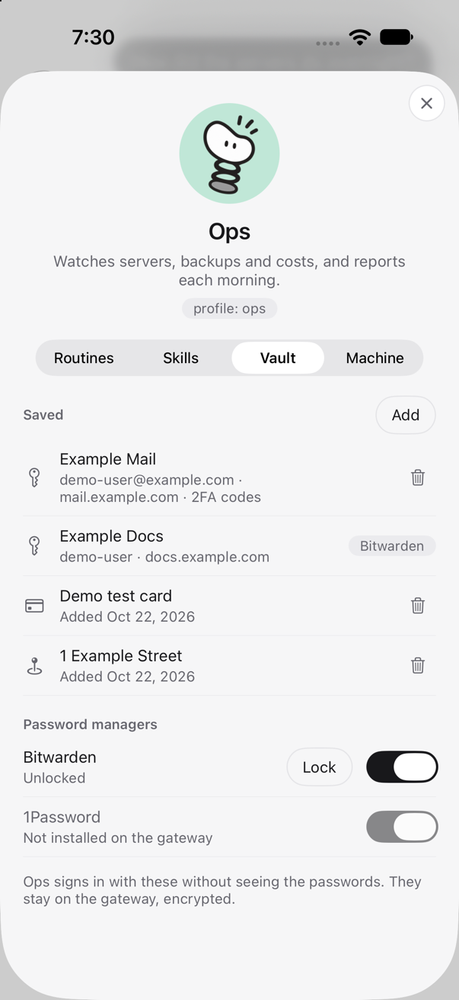
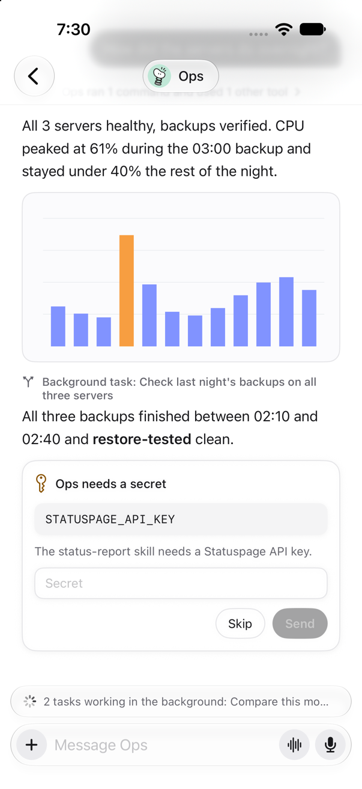
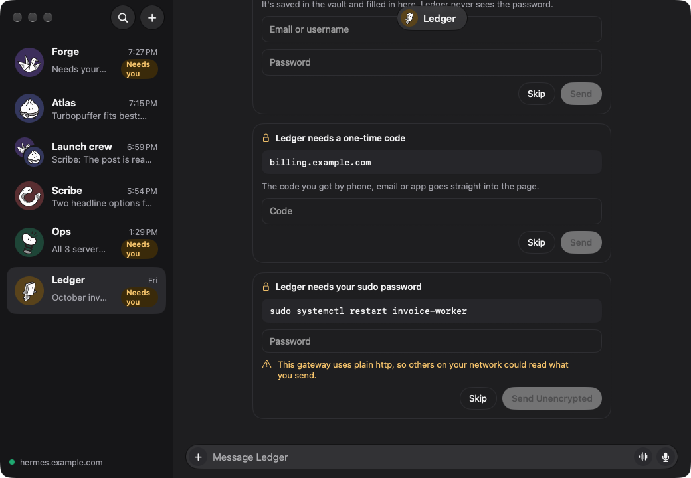

# User guide

A tour of what Usual Bot does, in the order you'll meet it. Everything works the same on Mac and
iPhone unless a section says otherwise.

- [Contacts and the sidebar](#contacts-and-the-sidebar)
- [Chatting with an agent](#chatting-with-an-agent)
- [Approvals and questions](#approvals-and-questions)
- [Skills and commands](#skills-and-commands)
- [Side questions and background tasks](#side-questions-and-background-tasks)
- [Model, thinking and context](#model-thinking-and-context)
- [Dictation and voice calls](#dictation-and-voice-calls)
- [Rooms](#rooms)
- [An agent's profile: routines, skills and machine](#an-agents-profile-routines-skills-and-machine)
- [Quick message (Mac)](#quick-message-mac)
- [Offline and reconnecting](#offline-and-reconnecting)
- [Settings](#settings)
- [Keyboard shortcuts](#keyboard-shortcuts)

## Contacts and the sidebar

Usual Bot follows Hermes [Bot Mode](https://hermes-agent.nousresearch.com/docs/user-guide/bot-mode).
Each Bot (a Hermes profile) on your gateway is a contact, with one ongoing chat: the same "Bot
Chat" the Hermes desktop app keeps for it. Bot Mode's group chats are the rooms, in the same
list. The most recent conversation is at the top.

- A Bot shows the picture you gave it in the Hermes app. Without one, it gets one of Usual Bot's
  characters.
- An avatar that gently moves means the agent is working.
- A dot on the avatar means it needs you: it's waiting for your approval or an answer.
- On the Mac, ⌘K or the Search button finds a chat or room, and opens New Room, Settings or a theme.
  On iPhone, search filters the list.
- Search also finds messages once you type two letters or more: under the chats, Messages lists
  the newest that hold every word you typed, from all your chats and rooms, ignoring case and
  accents, with when each was said. Choose one to open its chat at that message, highlighted for a
  moment. The app searches what it has loaded first: everything once a chat is connected, and your
  recent messages until then or while offline (search says so). For a Bot whose chat isn't loaded
  yet, the gateway searches the rest and adds its best match, marked "Earlier"; opening it loads the
  chat and goes to the message. The gateway's search doesn't cover rooms, and a chat too long for
  the gateway to send can't be opened at an older message.
- The dot at the bottom of the sidebar shows the connection. Click it to see the gateway and to
  sign out. On iPhone the dot sits on the settings gear at the top left; tap it, then your gateway,
  for its details, Built-in Tailscale and Sign Out.

On the Mac, press the sidebar button or drag the sidebar narrower and it becomes a rail of avatars, with a line between
sections.

### Sections

Sections group the sidebar however you like. Until you make one, the list has no headings.

- **Make one:** right-click a chat on the Mac, or touch and hold it on iPhone, and choose **Move to
  New Section**. Type a name and press Return.
- **Move a chat:** use **Move to Section** in the same menu, or on the Mac drag it to a section.
  **Remove from Section** puts it back under Other, which holds everything not in a section.
- **Fold a section:** click its heading. A folded section still shows the needs-you dot or an unread
  count, so nothing waiting for you goes out of sight.
- **Rename, reorder or delete one:** right-click its heading on the Mac, or touch and hold it on
  iPhone.
  Deleting a section keeps its chats: they move to Other.

A Bot's section is saved on the Bot, so it shows on your other devices and in the Hermes desktop
app. Each device keeps its own order of sections, what's folded, and which section a room is in.
Searching lists every match together, without headings.

## Chatting with an agent

Type in the message box and press Return to send (Shift-Return for a new line). On Mac, Settings
can change sending to ⌘Return, leaving Return for new lines. Replies stream in
as the agent writes them, with Markdown, code blocks you can copy, and tables. While the agent uses
tools, one line such as "Forge edited 1 file and ran 1 command" sums them up; click it to see each
step.

A date such as "Yesterday 12:27 PM" sits above the first message and again after a new day starts
or an hour passes. Hover a message on the Mac to see its time, or long-press it on iPhone.

A chat opens at its newest message and follows new replies while you’re at the end. Scroll up to
read older messages without being pulled back down; scroll to the end to follow replies again.

- **Attachments.** Use **+**, drag and drop, or paste. On iPhone, pick from Photos, the camera or
  Files. Images up to 25 MB and other files up to 50 MB.
- **Images from the agent.** When a reply names an image (a screenshot, a chart, a generated
  picture), it shows inline. Click it for full size, to share or to save.
- **While the agent works.** The line above the box says what it's doing: reading, running a
  command, waiting on its provider or compressing the conversation. If it keeps a to-do list or
  hands work to helpers, a line such as "2 of 5 done" or "2 helpers working" shows that; click it to
  see each one. A helper left working in the background stays listed after the reply until it
  finishes.
- **Stop and steer.** While a reply runs, the send button becomes Stop. Or just send another
  message: it steers the running turn instead of waiting for it.
- **React, reply, copy.** Hover a message on the Mac, or long-press it on iPhone. Reply quotes the
  message above the box.
- **Edit and undo.** On your last message, **Edit** puts it back in the box; send it to replace the
  exchange and get a fresh answer. **Undo** takes the last exchange back.

## Approvals and questions

When an agent wants to do something that needs your OK, such as running a command, a card appears
in the chat with what it wants to run and why:

| Button | What it does |
| --- | --- |
| **Allow once** | Runs it this time only. |
| **Allow in this chat** | Allows this kind of command for the rest of this chat. |
| **Always allow** | Adds it to the agent's permanent allow list. |
| **Deny** | Refuses; the agent is told and carries on. |

When an agent asks you a question with choices, the same kind of card shows the options; pick one
or type your own answer. When it asks one thing with one answer, the card is lighter: tap a choice,
or type your answer in the message box, which says **Answer** while the question waits. **✕** skips
it. Approvals also wait in the ⌥Space panel on the Mac, so you can answer
without opening the chat.

When a skill needs a secret, such as an API key, or a command needs your sudo password, a card asks
for it in a masked field. **Send** gives it to your gateway, and **Skip** lets the agent carry on
without it. A secret is saved on the gateway under the name the card shows; Usual Bot keeps no copy.
If your gateway uses plain `http` away from this device and outside Tailscale, others on your
network could read what you send, so the card warns you and the button says **Send Unencrypted**.

Agents can sign in to sites for you without seeing your passwords. Open a Bot's profile and pick the
**Vault** tab to see what's saved for it (labels, usernames and sites, never the secrets), add a
login, card or address, remove one, or switch on, unlock or lock a password manager on the gateway.
In a chat, cards ask for a master password, a login to save or a one-time code, and you can skip any
of them. On that same kind of plain `http` gateway, nothing secret goes out until you tick **Send it
anyway** for that send.

  
  

### Connecting an app

When an agent needs one of your accounts, such as Gmail or Notion, or an MCP server's sign-in, a card
asks to connect it. **Connect** opens the app's own sign-in page: in your browser on the Mac, in a
sign-in sheet on iPhone. Sign in there and the card updates by itself, then the agent carries on.
The sheet on iPhone closes once Hermes says the app is connected.

- **Not now** skips every app still waiting, and the agent goes on without them.
- If a sign-in fails or its link expires, the row says why and offers **Try Again**.
- An app that needs a key typed in, or a plugin to review, says to set it up in the Hermes app.
- The agent waits up to five minutes. After that, or if you stop the reply, the card goes and the
  chat says which apps didn't connect. Offline, the card stays and its buttons wait for the gateway.

Hosted apps like Gmail sign in through the Nous Portal account Hermes uses, so the gateway needs one.
An MCP server's sign-in sends your browser back to the gateway, so the gateway's address must open in
this device's browser; on iPhone with a tailnet gateway that means the Tailscale VPN is on. Rooms show
no card: there the agent posts the sign-in link in its reply.

## Skills and commands

Type `/` anywhere in the message box to open a menu of the agent's skills (✦) and Hermes's commands
(⌘). Keep typing to filter, use the arrow keys to move, and Return or Tab to pick.

- **Skills** are the agent's installed skills, such as `/web-research`. Picking one adds it to your
  message; write the rest and send.
- **Commands** are Hermes's own, such as `/reasoning high`, `/status`, `/usage`, `/compress`,
  `/retry` or `/undo`. Their output shows in the chat as a small block.

Commands that only make sense in a terminal or the desktop app are left out of the menu.

## Side questions and background tasks

- **`/btw <question>`** asks about the conversation without interrupting the agent. The answer
  appears in a card above the message box; close it when you're done. It isn't added to the chat.
- **`/bg <task>`** (or `/background`) hands the task to a fresh agent that runs on its own, while
  you keep chatting. A bar above the message box shows what's running; when a task finishes, its
  result joins the chat and you get a notification if the app isn't in front. If you quit the app
  meanwhile, the result is picked up the next time you open it.

## Model, thinking and context

On the Mac they sit below the message box, on the right:

- **The model menu** switches the model for this chat only. Expensive models ask first. If the
  agent is mid-reply, the switch takes effect from your next message.
- **The thinking menu** sets how hard the model reasons (for models that can).
- **The context meter** shows how full the conversation's context window is, and turns amber past
  80%. Its menu has **Compress Conversation**, which summarises older messages to free space.

Both menus also offer **Make Default for <agent>**, which saves the choice as the agent's default
everywhere, including in the official Hermes app.

On iPhone they appear inside the message box while you type, in the row of buttons under your
text:

- **The context ring** shows how full the context is; tap it for the numbers and **Compress
  Conversation**.
- **The gauge** shows how hard the model thinks: its needle rises with the level. Tap it to open a
  slider of levels above the box, with the keyboard still up; tap or slide to a level.
- **The model name** above the slider opens **Model and thinking**, with the full model list and
  every level, each with **Make Default for <agent>**.

## Dictation and voice calls

- **Dictation.** In an empty message box, tap the mic and speak. Words appear as you talk,
  recognised on the device when it can. Tap the mic again to stop, then edit and send.
- **Voice calls.** Tap the waveform button to call the agent. It hears you, answers aloud as it
  writes, and stops when you talk over it. The conversation is saved in the chat as usual. The call
  bar above the message box has the transcript, mute, end and settings, where you pick the voice,
  speed and engine:
  - **On-device** speech uses Apple's speech recognition and voices. Free, and nothing extra leaves
    your device.
  - **GPT-Live** uses OpenAI's realtime voice through your gateway, for a more natural
    conversation. It's offered when the gateway has an OpenAI key, and OpenAI bills the minutes.

## Rooms

Rooms are group chats with several agents. Create one with **+** at the top of the sidebar, name it
and pick its members.

- A message goes to every agent in the room; `@name` talks to just one.
- Each reply shows who wrote it. Agents can hand work to each other, shown as small lines in the
  conversation.
- Type `/` for the members' skills. ⌘I (or the room's name) shows its members.
- To rename or delete a room, use **Rename Room…** or **Delete Room…** at the bottom of its panel,
  or right-click it in the sidebar (touch and hold on iPhone). Deleting stops any agent still
  answering and removes the room and its messages for good; the agents and their own chats stay.
- If a reply stops partway, say because the gateway restarted, the room shows the needs-you dot and a
  card with **Try Again**. The room waits until you do. The agent may have done part of the work
  already, so trying again can repeat it.

Rooms are text only on the dashboard gateway: attachments in rooms need Hermes's newer gateway.

## An agent's profile: routines, skills, apps and machine

Click the agent's name at the top of the chat (⌘I) to open its profile beside the chat. On iPhone,
tap the name or **…** › **View Profile**: the profile opens as a page with a row for each part below,
showing at a glance how many are on.

- **Routines** are the agent's scheduled jobs. Each shows when it runs, whether it's on, and why the
  last run failed if it did. The switch pauses or resumes one.
  - **New Routine** asks for a name, what to do, when, and where results go. **When** offers every
    day, weekdays, every week, every month, every hour and every 15 minutes, or **Custom** for text
    like "every 2h", "every monday 9am", "0 9 * * 1-5" or "in 30m". If the gateway can't read it,
    it says which forms it accepts.
  - **Templates:** New Routine also lists the gateway's templates, such as a morning briefing or a
    price watch, each with a line about it. Pick one, answer its few questions and choose where
    results go; it shows when it will run. Hermes writes the instructions from your answers, and
    the new routine opens so you can read them and **Edit** anything. If it uses a skill the agent
    doesn't have, or one that's turned off, it says so: add the skill in Hermes or turn it on under
    **Skills**, or the routine runs without it. An older gateway without templates goes straight to
    the blank form.
  - **Results:** **Post in this chat** sends each result to the agent here, and it replies, which
    uses a turn. **Keep in past runs only** posts nothing. A routine set up to send elsewhere, such
    as Telegram, keeps going there unless you change it.
  - Open a routine to **Edit** it, **Run Now**, **Delete** it, or read its **Past Runs**. Run Now can
    take a few minutes; you can close the sheet and keep going, and the routine shows when it's done.
    Running a paused routine turns it back on. A past run opens to what the agent said; a run that
    only ran a script shows the start of what it printed.
  - You can still ask the agent in the chat, for example "every Monday at 9, check our dependencies".
- **Skills** lists what the agent can do, with switches to turn skills on and off.
- **Apps** are the agent's MCP servers, which give it tools from other services. See
  [Apps](#apps) below.
- **Machine** shows the agent's model and provider, and the gateway's address, Hermes version,
  connection status and who you're signed in as. On the Mac, when the official Hermes app is
  installed, a button opens it for advanced settings.

### Apps

The Apps tab lists the agent's MCP servers with where each runs: a web address or a program on the
gateway's machine. The switch turns one on or off. One marked Plugin comes with a Hermes plugin and
can't be changed here.

- **See its tools.** Click an app. Usual Bot connects to it from the gateway and lists its tools.
  Test Connection does that again.
- **Add an app.** Add app opens Hermes's catalog. Pick one, fill in any key it asks for, and add it.
  Custom adds one by web address, with an optional token, or by a command and its arguments. Keys and
  tokens go to the gateway and are saved there, not on this device. On a plain http gateway away from
  this device and outside Tailscale, tick "Send it anyway" to send one.
- **Sign in.** An app that signs in with its provider's page shows Sign In. Usual Bot opens the page
  in your browser; sign in there and come back. The sheet updates on its own. The provider sends your
  browser back to the gateway, so the gateway's address must open in this device's browser.
- **Remove** takes the app off the agent. A key or sign-in saved for it stays on the gateway.

**Connected accounts**, under the MCP servers, lists the apps Hermes can reach through your Nous
Portal account, connected ones first. **Connect** opens the app's sign-in page and the row says
Connected once you're done; **Disconnect** removes the account from your Nous Portal, so every agent
that uses it loses it. The section shows only when the gateway has a Nous Portal account.

A change reaches the agent's next session. To use it in the chat that's open now, choose Apply to the
Open Chat. Hermes reloads the agent's apps, and its next reply costs more, because the whole
conversation is sent again.

## Quick message (Mac)

Press **⌥Space**, or the shortcut you chose in Settings, to open a small panel over whatever
you’re doing.

- Pick the agent along the top (Tab moves to the next), type, and press Return to send. The answer
  shows in the panel.
- ⌘Return opens the full chat; Esc closes the panel.
- **Waiting on you** lists approvals from every agent, with Allow and Deny.

Usual Bot keeps running in the menu bar after you close its window. Quick Message stays available
there even if you disable its shortcut. Quit the app from the menu bar item.

## Offline and reconnecting

The app caches your recent chats, so they open instantly and stay readable without a connection.
When the connection drops, it reconnects by itself and catches up on what it missed: replies that
arrived meanwhile, background results and side answers. On iPhone, the connection closes when the
app goes to the background and reopens when you come back.

If an answer couldn't be recovered (for example, the gateway restarted meanwhile), the chat says
so instead of leaving you waiting.

## Settings

Open **Settings…** from the Usual Bot menu (⌘, on Mac), the menu bar item, or the gear beside the
connection indicator. On iPhone the gear sits at the top of the list, with a dot for the connection,
and Settings opens with your gateway at the top. Preferences stay on this device.

- **General:** follow the system appearance or choose light or dark, and change chat text size.
  On Mac, choose Return or ⌘Return to send messages, and whether to launch at login.
- **Quick Message (Mac):** in General, click the keyboard shortcut and press a new combination
  including Control, Option or Command. Esc cancels. A shortcut macOS refuses leaves your previous
  choice in place. **Disable Shortcut** keeps Quick Message available from the menu bar;
  **Restore Default** tries ⌥Space, then ⌃⌥Space if needed. The menu bar shows the active shortcut.
  Quick Message itself always uses Return to send and ⌘Return to open the full chat.
- **Notifications:** choose what alerts you: messages and replies, an agent needing you, and
  background tasks finishing, plus sounds and previews. With previews off, new alerts say only who
  it's from. System notification settings and Focus also apply. Alerts appear when you're
  not using Usual Bot, and tapping one opens that chat. On the Mac the app must be running, in the menu bar
  is enough. iPhone alerts from the app itself aren't instant: it disconnects soon after you leave,
  and iOS decides when it can check in.
- **Push:** for instant alerts anywhere, even with the app closed, install the plugin in
  [`Integrations/hermes-push`](../../Integrations/hermes-push/README.md) on your gateway and pick
  ntfy or Pushover under Notifications. They arrive in that service's app. Tapping one in ntfy opens
  the chat in Usual Bot; in Pushover, tap it, then **Open in Usual Bot**. Push stays quiet while
  you're using Usual Bot on any device, so a Mac in front also quiets your iPhone until its screen
  sleeps.
- **Voice:** choose the call engine and the language, voice and speed for on-device speech. These
  preferences are shared with the controls inside a call; GPT-Live’s voice stays on the gateway.
- **Connection:** see the gateway address, status, version and identity when available, or sign out.
  Signing out removes the saved sign-in and cached chats for that gateway from this device.
- **Usage:** see where your Bots' tokens went over the last 7, 30 or 90 days: a chart per day,
  the total, the cost when Hermes knows it, and the share each Bot used. On iPhone it's the row
  under your gateway. **Where the tokens went** splits them into what the model wrote, what was
  sent to it new, and what was sent again (the chat so far and the Bot's instructions, resent with
  every step, which providers charge less for), then the background work Hermes does beside your
  chats, such as shortening long chats or naming them. Choose a Bot for its own numbers. A Bot's
  usage includes its routines and any other apps it talks in; room replies count toward the Bot that
  wrote them. Hermes files a conversation under the day it began, so a long chat's tokens show on
  its first day, and one that began before the period isn't counted. Costs are Hermes's estimate
  from its price list unless your provider reports them, and models without a price count as
  nothing. An older Hermes doesn't report usage; updating it on the gateway adds it.

The About section has the app version, guide, source and license links. Agent configuration,
provider keys and gateway administration stay in Hermes.

## Keyboard shortcuts

| Shortcut | Where | What it does |
| --- | --- | --- |
| ⌥Space (configurable in Settings) | Anywhere (Mac) | Opens the quick message panel |
| ⌘K or ⌘F | Anywhere in the window | Search chats, messages and actions |
| ↑ / ↓ | Sidebar | Move between chats |
| ⌘, | Mac | Open Settings |
| ⌘I | Chat or room | Show the profile or room details |
| Return | Message box | Send by default, or pick from the open `/` or `@` menu |
| ⌘Return | Mac message box | Send when chosen in Settings |
| Shift-Return | Message box | New line |
| ↑ / ↓, Tab | `/` or `@` menu | Move, pick |
| Esc | `/` or `@` menu, reply, edit | Close the menu or cancel |
| Tab | Quick message | Next agent |
| ⌘Return | Quick message | Open the full chat |
